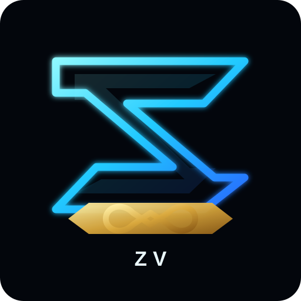

  

<h1 align="center">Zorathvael (ZV)</h1>

<em>From Fragility to Resilience.</em>

Audience → Holders → Community → Ecosystem.

  <a href="https://pump.fun/coin/7dWLzsJkWNYnLShY7QqqPqeWSapzv2nYBjknEj1pump">Solana / pump.fun</a> ·
  <a href="https://solscan.io/token/7dWLzsJkWNYnLShY7QqqPqeWSapzv2nYBjknEj1pump">Solscan</a> ·
  <a href="https://bscscan.com/token/0x2c6b35f3e70500b1189e331547b493904c598888">BNB Chain / BscScan</a> ·
  <a href="https://github.com/KikikJourney/Zorathvael-ZV/issues">Issues</a>

> **Risk notice:** ZV is a meme token and may be highly volatile or lose all of its value. This repository is informational, not financial, investment, legal, or tax advice. Never share seed phrases or private keys.

## Project and network overview

This repository is the shared documentation home for the Zorathvael project across two separate networks. **The Solana mint and the BNB Smart Chain contract are different on-chain assets.** A shared name, ticker, logo, or repository does not make them the same token, automatically bridge them, or combine their supplies, liquidity, holders, or ownership.

| Field | Solana | BNB Smart Chain |
|---|---|---|
| Project name | Zorathvael | Reported as Zorathvael; on-chain metadata not yet independently verified |
| Ticker | ZV (project label) | ZV (project label; on-chain metadata not yet independently verified) |
| Network | Solana | BNB Smart Chain (BSC) |
| On-chain identifier | `7dWLzsJkWNYnLShY7QqqPqeWSapzv2nYBjknEj1pump` | `0x2c6b35f3e70500b1189e331547b493904c598888` |
| Explorer | [Solscan](https://solscan.io/token/7dWLzsJkWNYnLShY7QqqPqeWSapzv2nYBjknEj1pump) | [BscScan](https://bscscan.com/token/0x2c6b35f3e70500b1189e331547b493904c598888) |
| Supply status | 1,000,000,000 tokens observed in RPC snapshot dated 2026-10-12 18:32:32 UTC | 1,000,000,000 tokens observed via RPC; project owner previously reported 1,000,000 (discrepancy documented) |

- [Solana token details](chains/solana.md)
- [BNB Smart Chain token details](chains/bnb-smart-chain.md)
- [Combined token information and verification status](docs/TOKEN-INFO.md)
- [On-chain verification procedure](docs/VERIFICATION.md)

## Verification status

The Solana mint has a dated read-only RPC snapshot documented in [Token Information](docs/TOKEN-INFO.md). The BNB contract address and 1,000,000-token supply were supplied by the project owner; the BNB contract's name, symbol, decimals, actual supply, source-code verification status, and administrative privileges still need independent checks. Do not treat user-provided details as verified blockchain facts.

A blockchain explorer page is a starting point for verification, not by itself a security audit or proof of legitimacy, ownership, liquidity, or value. Always compare the full address before interacting with a token.

## Purpose and limitations

This is the public documentation and project-maintenance home for Zorathvael (ZV). It does not claim that ZV has its own blockchain, validator network, audited smart contract, bridge, utility, exchange listing, or guaranteed roadmap delivery. No cross-chain bridge or supply equivalence is implied by documenting both networks together.

## Security principles

1. Never request, store, commit, or share anyone's seed phrase, private key, wallet export, or access token.
2. Verify each network's complete address independently; names, tickers, and logos do not uniquely identify a token.
3. Never publish unverified claims about supply, authorities, liquidity locks, audits, partnerships, or utility.
4. Treat unsolicited DMs, fake support accounts, airdrops, and links as potentially malicious.
5. Document changes through reviewable commits. Do not fake activity, holders, endorsements, or audit status.

## Repository map

- `chains/solana.md` — Solana mint and snapshot
- `chains/bnb-smart-chain.md` — BNB contract and verification checklist
- `scripts/verify_bnb_contract.py` — read-only BNB contract verifier
- `.github/workflows/bnb-verification.yml` — automated BNB verification workflow
- `docs/TOKEN-INFO.md` — combined network comparison
- `docs/VERIFICATION.md` — Solana verifier procedure
- `assets/logo.svg` — existing vector brand mark (not the original pump.fun image)
- `SECURITY.md` — security policy
- `CONTRIBUTING.md` — contribution guide
- `CODE_OF_CONDUCT.md` — community code of conduct

## Disclaimer

Cryptocurrency assets are risky, speculative, and may be illiquid. Nothing in this repository is a promise of profit, price performance, liquidity, exchange listing, or future development. Information can become outdated; independently verify on-chain facts before acting.
